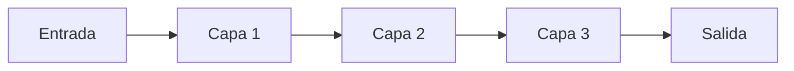
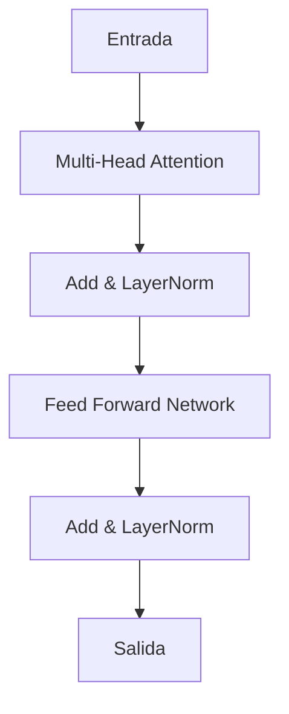
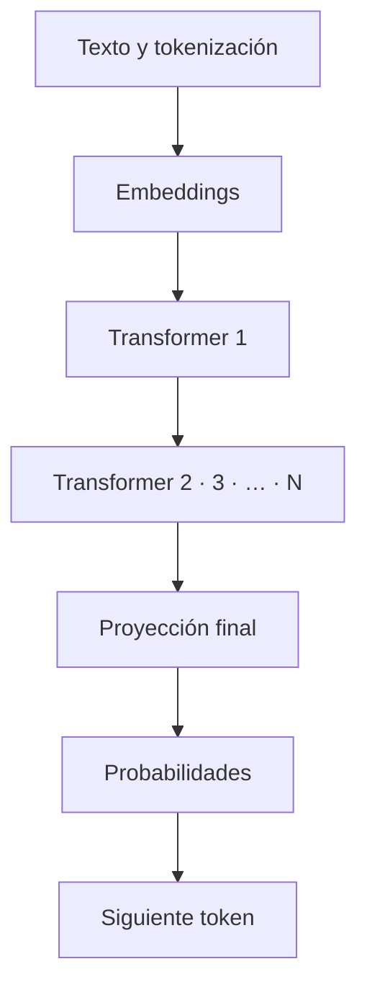

# Transformer y atención

Cómo se relacionan los tokens y cómo se transforma su representación.

<!-- Fuente: secciones 3 y 5. -->

---
module: 03 / Transformer y atención
---

# La arquitectura Transformer

2017<h3>Attention Is All You Need</h3>
Una arquitectura de red neuronal que utiliza atención para relacionar elementos del texto.
<CourseResource path="/resources/attention-is-all-you-need.pdf">Leer el artículo original</CourseResource>

<SourceImage src="/images/03-transformer/arquitectura.png" alt="Transformer: arquitectura presentada en 2017 que procesa tokens" :height="350" />

<!-- Fuente: §3, image 4.png y PDF adjunto 1706.03762v7.pdf. El texto atribuye la propuesta a investigadores de Google. La atención permite relacionar palabras alejadas y es base de muchos LLM, como GPT, para traducir, resumir y responder preguntas. -->

---
module: 03 / Transformer y atención
---

# Una red neuronal transforma datos

Cada capa realiza operaciones matemáticas sobre la representación que recibe.

La salida de una capa es la entrada de la siguiente.

<!-- Fuente: §3.1. Este diagrama conserva los cinco elementos del esquema ASCII original. -->

---
module: 03 / Transformer y atención
---

# Dentro de un bloque Transformer

<strong>Atención:</strong> permite que un token use información de otros tokens.

<strong>Add & LayerNorm:</strong> conexión residual y normalización.

<strong>Feed forward:</strong> red que transforma la representación.

Versión simplificada del bloque original. Las variantes pueden cambiar el orden.

<!-- Fuente: §3.2 y PDF adjunto, §3.1. Se preserva el orden del esquema original. El artículo define la conexión residual seguida de normalización y la red feed-forward. Este dibujo no es el detalle completo del decoder. -->

---
module: 03 / Transformer y atención
---

# Atención: relaciones dentro de la oración

«El gato se acostó en el sofá porque estaba cansado».

<Arrow v-click="2" x1="1010" y1="8" x2="105" y2="8" color="#2b90b6" width="2" />
«cansado» se relaciona con «gato»

<h3>Relevancia</h3>
Al procesar «cansado», el modelo puede dar más importancia a «gato» que a «sofá».

<h3>Contexto</h3>
La atención combina información de otros tokens mediante cálculos numéricos.

<!-- Fuente: §3.2 y §5. Se conserva el ejemplo del gato. «Puede» importa: no se afirman pesos reales de atención ni se equipara este cálculo con entendimiento humano. -->

---
module: 03 / Transformer y atención
---

# Relaciones que puede captar la atención

<SourceImage src="/images/03-transformer/relaciones-atencion.png" alt="Relaciones sintácticas y semánticas, referencias por pronombres y contexto general" :height="425" caption="Sintaxis, relaciones semánticas, referencias y contexto mediante representaciones aprendidas." />

<!-- Fuente: §5 e image 9.png. La imagen añade sujeto-verbo, sinónimos, analogías y referencias por pronombres. No se atribuye una comprensión consciente al mecanismo. -->

---
module: 03 / Transformer y atención
---

# Representaciones en las primeras capas

<SourceImage src="/images/03-transformer/primeras-capas.png" alt="Esquema de las primeras capas y la representación de palabras individuales" :height="410" caption="El material ilustra un procesamiento inicial más centrado en las partes de la oración." />

<!-- Fuente: §3 e image 5.png. Es una intuición didáctica, no una separación rígida: la atención ya incorpora contexto dentro de los bloques. -->

---
module: 03 / Transformer y atención
---

# Representaciones en capas posteriores

<SourceImage src="/images/03-transformer/capas-posteriores.png" alt="Esquema de capas posteriores que combinan información de la oración" :height="410" caption="Las transformaciones sucesivas combinan información y refinan la representación contextual." />

<!-- Fuente: §3 e image 6.png. La imagen contrasta la mirada inicial con la integración posterior del sentido de la oración. -->

---
module: 03 / Transformer y atención
---

# Un LLM apila muchos bloques

Cada bloque transforma las representaciones que recibe del anterior.

La proyección final permite obtener probabilidades para el siguiente token.

La generación repite este proceso con el contexto acumulado.

<!-- Fuente: §3.3. Todos los elementos del esquema ASCII se conservan, agrupando los bloques intermedios para facilitar la lectura. -->

---
module: 03 / Transformer y atención
---

# Ejemplos de profundidad

36<h3>GPT-2 Large</h3>
Bloques Transformer.

96<h3>GPT-3 de 175B</h3>
Bloques Transformer.

En estos ejemplos, «capas» se refiere a bloques completos apilados.

<!-- Fuente: §3.3 y §3.4. Se conservan los modelos y cifras históricos del documento. -->

---
module: 03 / Transformer y atención
---

# Arquitectura, bloque y subcapa

Diseño completo
<h3>Arquitectura</h3>
Organiza las representaciones de entrada, los bloques y la salida del modelo.

Unidad repetida
<h3>Bloque</h3>
Se apila y funciona como una «capa grande» del modelo.

Dentro del bloque
<h3>Subcapas</h3>
Atención, red feed forward y normalización.

El significado de «Transformer» depende del nivel de abstracción.

<!-- Fuente: §3.4 completo. El flujo descrito en el curso incluye tokenización, embeddings, bloques y proyección final. -->

---
module: 03 / Transformer y atención
---

# Encoder y decoder en el modelo original

<SourceImage src="/images/03-transformer/encoder-decoder.png" alt="Esquema introductorio de encoder y decoder del material" :height="290" />

<h3>Encoder</h3>
Transforma la secuencia de entrada en representaciones.

<h3>Decoder</h3>
Usa esas representaciones y la salida previa para generar la secuencia de salida.

El dibujo es una simplificación. El artículo describe la arquitectura completa.

<!-- Fuente: §3.5, image 7.png y PDF adjunto, §3 y §3.1. La imagen abrevia encoder como prompt y decoder como lenguaje de LLM. Se aclaran sus funciones usando el propio PDF para evitar tomar esa abreviación como definición técnica. -->
