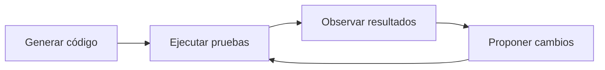

# Programación con IA

Cómo aprende patrones de código y qué aporta la verificación.

<!-- Fuente: §9 completo y curvas conceptuales de adopción. -->

---
module: 06 / Programación con IA
---

# Cómo aprende patrones de programación

<v-clicks :at="1" animation="fade-in up">
<ol class="steps">
<li><div><h3>Texto y código</h3><p>Código fuente, documentación, tutoriales y conversaciones sobre programación.</p></div></li>
<li><div><h3>Predicción y ajuste</h3><p>Tokenizar, predecir el siguiente token, medir el error y ajustar parámetros.</p></div></li>
<li><div><h3>Regularidades aprendidas</h3><p>Sintaxis, estructuras comunes y relaciones entre instrucciones y código.</p></div></li>
</ol>
</v-clicks>

<!-- Fuente: §9 y §9.1. El modelo puede generar, explicar y modificar programas usando patrones aprendidos. No aprende exactamente como una persona ni comprende perfectamente cada programa. -->

---
module: 06 / Programación con IA
---

# Predicción dentro de un fragmento de código

<p class="lead">El modelo aprende qué tokens suelen continuar una secuencia como esta:</p>

```js
function sumar(a, b) { return
```

<p class="small muted">Fragmento intencionalmente incompleto del material original.</p>

<p v-click="1" class="takeaway">Una continuación plausible puede ser <span v-mark.circle="{ at: 1, color: '#2b90b6', multiline: true, padding: 3, strokeWidth: 2 }">incorrecta</span>. El entrenamiento no garantiza que el programa funcione.</p>

<!-- Fuente: §9.1. Se conserva literalmente el fragmento JavaScript original sin completar la función ni inventar una implementación. No es un ejemplo ejecutable. -->

---
module: 06 / Programación con IA
---

# Ajuste para seguir instrucciones

<p class="lead">Los ejemplos de solicitudes y respuestas ayudan a orientar el modelo hacia tareas de desarrollo.</p>

<div class="grid grid-cols-3 gap-6 mt-10">
<div v-click="1" class="concept-card"><h3>Explicar un error</h3><p>Relacionar la solicitud con patrones de errores y sus explicaciones.</p></div>
<div v-click="2" class="concept-card"><h3>Escribir pruebas</h3><p>Generar respuestas orientadas a verificar comportamiento.</p></div>
<div v-click="3" class="concept-card"><h3>Refactorizar código</h3><p>Proponer cambios a una implementación existente.</p></div>
</div>

<p v-click="4" class="takeaway">El resultado aún debe compilar, ser seguro y cumplir los requisitos.</p>

<!-- Fuente: §9.2. El ajuste busca respuestas más útiles, claras y seguras, sin garantizar corrección ni cumplimiento. -->

---
module: 06 / Programación con IA
---

# Herramientas para probar y corregir



<p class="lead mt-8">Un intérprete, las pruebas automatizadas o un entorno de desarrollo permiten comprobar la propuesta.</p>

<p v-click="1" class="takeaway">Corregir dentro de una sesión <span v-mark.underline="{ at: 1, color: '#2b90b6', multiline: true, padding: 3, strokeWidth: 2 }">no cambia permanentemente</span> los parámetros del modelo.</p>

<!-- Fuente: §9.3. Solo algunos asistentes tienen esas integraciones. Los cambios suelen quedar en la respuesta o el contexto. El aprendizaje duradero requiere que sus responsables incorporen datos y realicen un nuevo entrenamiento o ajuste. -->

---
module: 06 / Programación con IA
---

# Ejemplo: el promedio de una lista

<p class="lead">«Escribe una función que calcule el promedio de una lista».</p>

<v-clicks :at="1" animation="fade-in up">
<ol class="steps">
<li><div>La persona formula la solicitud.</div></li>
<li><div>El modelo usa los patrones aprendidos para interpretarla.</div></li>
<li><div>Genera una solución posible y explica cómo funciona.</div></li>
<li><div>Si tiene herramientas, ejecuta pruebas y revisa resultados.</div></li>
<li><div>La persona verifica el código y señala las correcciones.</div></li>
</ol>
</v-clicks>

<!-- Fuente: §9.4 completo. El material propone el proceso, pero no incluye una implementación de la función promedio. Se preserva como actividad guiada sin inventar una solución. -->

---
module: 06 / Programación con IA
---

# Problemas al generar código

<div class="grid grid-cols-2 gap-12 mt-8">
<div v-click="1" class="rule-block"><h3>Conocimiento desactualizado</h3><p>El entrenamiento puede contener bibliotecas o <span v-mark.underline="{ at: 1, color: '#2b90b6', multiline: true, padding: 3, strokeWidth: 2 }">versiones antiguas</span>.</p><p>El modelo puede inventar funciones, APIs o métodos que no existen o ya no funcionan.</p></div>
<div v-click="2" class="rule-block"><h3>Contexto incompleto</h3><p>Pegar un fragmento en una ventana de chat no describe todo el proyecto.</p><p>Pueden faltar <span v-mark.underline="{ at: 2, color: '#2b90b6', multiline: true, padding: 3, strokeWidth: 2 }">estructura, dependencias y convenciones</span>.</p></div>
</div>

<p v-click="3" class="takeaway">El código debe evaluarse en el contexto real del proyecto.</p>

<!-- Fuente: §9.5 y aviso Problemas comunes al programar con IA. -->

---
module: 06 / Programación con IA
---

# Revisión y aprendizaje

<div class="grid grid-cols-2 gap-12 mt-10">
<div v-click="1" class="rule-block"><h3>Antes de usar el código</h3><ul><li>Revisar la propuesta.</li><li>Ejecutar pruebas.</li><li>Evaluar requisitos y seguridad.</li></ul></div>
<div v-click="2" class="rule-block"><h3>Para aprender programación</h3><ul><li>Pedir explicaciones.</li><li>Estudiar los fundamentos.</li><li>Escribir y depurar código por cuenta propia.</li></ul></div>
</div>

<p v-click="3" class="takeaway">La IA reconoce patrones. La persona verifica el resultado y comprende su uso.</p>

<!-- Fuente: §9.2 y §9.5. No se atribuye razonamiento consciente al modelo. -->

---
module: 06 / Programación con IA
---

# Integración y desarrollo de aplicaciones

<SourceImage src="/images/06-programacion/adopcion-y-encuesta.png" alt="Curva conceptual de adopción y cifras de encuesta reproducidas en el material" :height="430" caption="La curva es conceptual. Los porcentajes inferiores se solapan y no equivalen a sus cinco segmentos." />

<!-- Fuente: image 15.png. La imagen cita Stack Overflow Developer Survey 2026, AI tool usage, n = 17 464, respuestas múltiples entre profesionales tecnológicos. Se conserva el archivo íntegro. La siguiente lámina transcribe los datos para facilitar su lectura y conserva las limitaciones. -->

---
module: 06 / Programación con IA
---

# Lectura de las cifras de adopción

<v-clicks :at="1" animation="fade-in">

| Uso descrito en la imagen | Porcentaje |
| --- | --- |
| No utiliza herramientas de IA | 17.2 % |
| Utiliza chats de IA de propósito general | 62.5 % |
| Utiliza agentes de IA o flujos automatizados | 26.2 % |
| Utiliza herramientas internas de IA de su empresa | 17.8 % |

</v-clicks>

<p class="small muted">La imagen cita Stack Overflow Developer Survey 2026, n = 17 464. Son respuestas múltiples de profesionales tecnológicos, con categorías que se solapan.</p>

<!-- Fuente: texto dentro de image 15.png. Transcripción de las cifras suministradas, no una verificación independiente de la encuesta. No se suman ni se asignan a los segmentos de la curva conceptual. No se extrapolan a toda la población. -->
